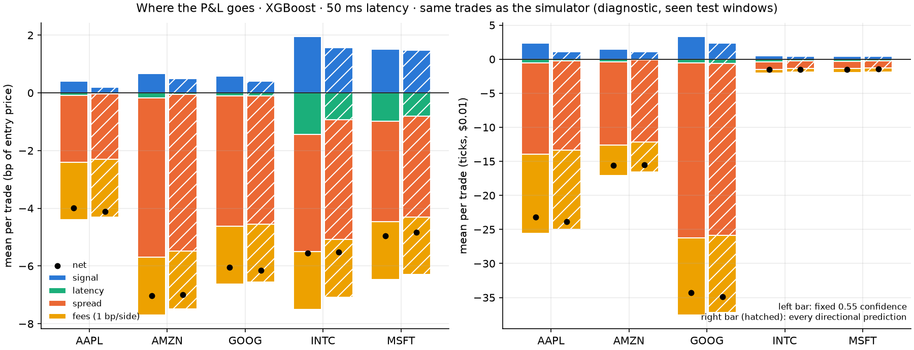
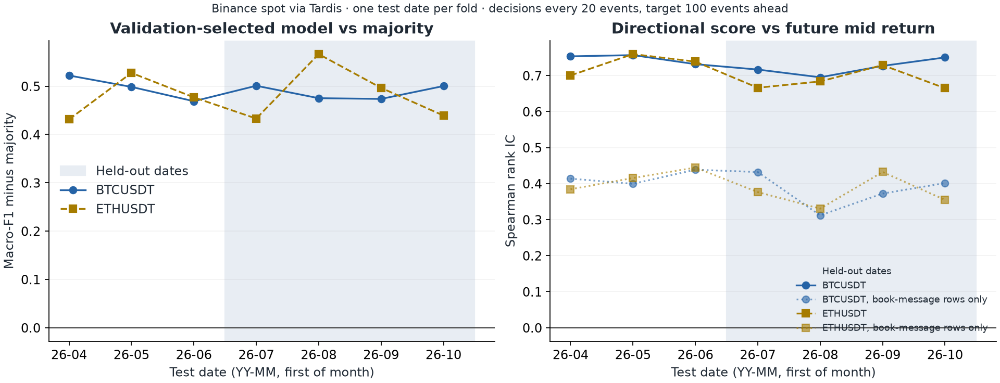

# Limit order book signals

**Order-book features predict the direction of short-horizon mid-price moves out of sample. Under the tested horizon, taker execution and cost assumptions, though, the predictable moves are smaller than the cost of trading them.** Validation-selected trading policies choose not to trade in every walk-forward fold. A cost breakdown shows why: the mid-to-mid signal is positive, and crossing the spread (equities) or paying the taker fee (crypto) takes several times that. The study does not show that these signals can never be traded profitably, only that they fail in the designs tested here.

The project has three parts:

1. **Equity baseline.** Official LOBSTER ten-level samples for AAPL, AMZN, GOOG, INTC and MSFT on 21 June 2012: 2,110,860 paired message/book events and 85,408 decisions. This is one historical session.
2. **Audit and economics diagnostics** on that baseline. They check correctness, explain the high rank ICs and decompose the losses. They re-read test windows already seen, so they explain the result rather than confirm it.
3. **Separate cross-market study** on Binance spot BTCUSDT and ETHUSDT (Tardis.dev free first-of-month files). There are 12 UTC dates, the last four held out and run once from a frozen commit. It tests whether a similar pattern appears across more dates in another market. It is never pooled with the equity sample, and the 100 ms resolution of its depth feed limits how its predictability can be read.

This is independent research on public historical data. It involves no live trading, and the backtests are displayed-quote simulations, not realised profits.


## Research question

Can order-flow and depth imbalance predict short-horizon mid-price moves out of sample? Does XGBoost add information beyond simple baselines? Does that information survive spread, fee and latency assumptions in a walk-forward backtest?

## Method

- **Events.** Every source event updates the features. A decision is made every 20 events, and the target is the mid-price direction (down/unchanged/up) 100 events later. For the equities, the median realised horizon is 3.2 s (10th–90th percentile 0.003–13 s). Equal-timestamp events keep their file order, and nothing after the exact decision row is used.
- **Features.** Best-quote order-flow imbalance over 500 ms and 5 s; depth imbalance at 1, 5 and 10 levels; microprice displacement; spread; log depth; trailing signed execution flow; event intensity; trailing returns. Windows reset at invalid books, halts and recording gaps.
- **Models.** A training-majority classifier, a fixed imbalance rule, standardised logistic regression and XGBoost. All settings were fixed before any real-data result, with no hyperparameter search.
- **Evaluation.** Expanding walk-forward: intraday for the single equity session (five folds per stock) and complete dates for crypto. Splits are purged through target time plus maximum latency. Preprocessing is fitted on training data only. The model and trading threshold are chosen on validation only, and "no trade" is always a candidate.
- **Metrics.** Macro-F1, directional hit rate *with coverage* (flat outcomes count as misses), Spearman rank IC of `P(up) − P(down)` against the future return, and 60 s block-bootstrap intervals (within-session uncertainty only).
- **Execution diagnostic.** One share, taker in and out at the displayed best quotes, no overlapping positions. The primary case is 50 ms latency; equities use an illustrative 1 bp per side, crypto Binance's published 10 bp taker fee. Sensitivities cover 0/50/200 ms and several fee levels. There are no passive fills, queue positions, impact or borrow.

Full fixed plans: [research plan](docs/RESEARCH_PLAN.md) (equity), [extension plan](docs/EXTENSION_PLAN.md) (crypto, committed before fitting), [economics plan](docs/ECONOMICS_PLAN.md).

## Results

### Equity baseline (one session, stitched test windows)

| | macro-F1 (majority) | hit rate | coverage | rank IC [95% block CI] | trades, primary scenario |
|---|---|---|---|---|---|
| AAPL | 0.388 (0.224) | 57.3% | 100% | 0.262 [0.234, 0.294] | 0 |
| AMZN | 0.407 (0.222) | 59.7% | 100% | 0.323 [0.276, 0.371] | 0 |
| GOOG | 0.392 (0.232) | 59.3% | 100% | 0.266 [0.206, 0.325] | 0 |
| INTC | 0.554 (0.287) | 58.5% | 12.8% | 0.523 [0.496, 0.549] | 0 |
| MSFT | 0.632 (0.269) | 59.3% | 26.6% | 0.561 [0.527, 0.588] | 0 |

The validation-selected model (XGBoost in 18 of 25 folds, logistic in 7) beats the majority baseline and the fixed imbalance rule on macro-F1 for all five stocks. XGBoost adds over logistic regression for INTC (0.554 vs 0.476) and MSFT (0.632 vs 0.563), but not for AAPL, AMZN or GOOG, where the two are within 0.02. Every fold's validation-selected threshold is "no trade". A fixed 0.55-confidence diagnostic, specified before the first run, trades and loses money after costs. Exact figures: [findings](docs/FINDINGS.md).

### What drives the IC ([audit](docs/AUDIT.md))

No material bug was found, so no headline number changed. The audit recomputed all 85,408 targets from raw rows and re-derived the model and threshold choice in all 25 folds. Trade and fee accounting reconcile.

- **INTC/MSFT** ($27–30, one-cent tick): the spread is one tick 78–79% of the time. The future mid is unchanged in 68–76% of cases, and 80–82% of non-zero moves are half-tick moves, when one best queue empties and the spread opens. Level-one imbalance alone reaches IC 0.46–0.49, about 90% of the model's IC.
- **AAPL/AMZN/GOOG** (spreads of 12–26 ticks): the IC comes mostly from short-term mid continuation and imbalance inside a wide spread.
- **Robustness:** non-overlapping subsets give the same IC, and the 60 s block intervals hold up. Decisions that fall inside an equal-timestamp burst (3–11%) follow the file-order rule but are not actionable. Excluding them lowers IC by 0.01–0.03.

This is genuine, well-known predictability of queue and spread dynamics. It is not the same thing as tradable edge.

### Why it does not pay ([economics](docs/ECONOMICS.md), diagnostic on seen windows)

| XGBoost, 0.55 diagnostic, 50 ms, 1 bp/side | AAPL | AMZN | GOOG | INTC | MSFT |
|---|---|---|---|---|---|
| signal, mid to mid (bp/trade) | +0.41 | +0.67 | +0.58 | +1.95 | +1.51 |
| spread paid (bp/trade) | −2.31 | −5.52 | −4.52 | −4.07 | −3.48 |
| net (bp/trade) | −3.99 | −7.02 | −6.04 | −5.56 | −4.96 |

The breakdown reconciles exactly with the simulator.
- **Expected move vs spread:** in none of 50 stock-score deciles is the expected move larger than the spread.
- **Fees:** with zero fees every stock still loses 2–5 bp per trade.
- **Perfect foresight:** a taker clears the spread on 0% (INTC, MSFT) to 9.7% (AAPL) of decisions with no fees, and at most 0.5% at 1 bp per side.
- **Cost-aware rule:** a rule written down before testing (trade only when the model's expected return exceeds the cost) never fires. The largest expected return was 1.9 bp, against costs of 4.3–7.5 bp.



### Cross-market study: Binance spot ([findings](docs/REPLICATION_FINDINGS.md))

| held-out dates 2026-07-01 to 10-01 | macro-F1 (majority) | hit rate / coverage | rank IC | IC at book-update rows | dates beating majority | validation-selected trades |
|---|---|---|---|---|---|---|
| BTCUSDT | 0.698 (0.199) | 70.5% / 61.6% | 0.733 | 0.388 | 4/4 | 0 |
| ETHUSDT | 0.656 (0.175) | 70.2% / 75.3% | 0.689 | 0.373 | 4/4 | 0 |

A similar pattern appears across dates: the model beats majority on all seven test dates per instrument (four held out), and validation never selects a trading policy. The headline predictability is materially affected by stale book updates (below). Read this as supporting evidence from a different market with a feed-resolution limitation, not as a confirmation of the equity numbers. Before fees, the fixed diagnostic earns +0.3 to +0.5 bp per position. Binance's 10 bp-per-side taker fee turns that into about −19.5 bp. The spread (one 0.01 USDT tick, about 0.001 bp) hardly matters here, unlike in the equities.

**Read the crypto IC with care.** Binance's depth stream batches book changes every 100 ms, while trades arrive one at a time. Most decisions fall on trade rows, which still carry the previous book update, and part of the "prediction" is the book catching up with trades already printed. At freshly updated book rows the IC is 0.37–0.39, comparable to the equities. This stale-book effect also makes the small pre-fee profit optimistic. The split by row type was a diagnostic added during development, before the held-out run; the primary analysis is as planned.

**The crypto results are conditional on complete recording windows.** After a development run hit recording gaps, a filter (`require_priced_exits`) was added before the held-out run. It drops decisions whose exit quote, at any tested latency, would fall in a different recording segment or on a stale quote. That uses knowledge of whether the *future* exit quote is available, so the sample is conditioned on future data availability. It removed 34 decisions in total (29 on held-out dates: BTC 23 on 2026-07-01, ETH 6 on 2026-08-01), out of about 1.38 million held-out decisions. The effect on the metrics is negligible, but it means the simulation is not fully actionable as run. The equity study applies a comparable rule (the target row must be valid and in the same segment), which removed nothing because the 2012 sample has no invalid segments.



## Limits

- **Equities:** one session from 2012, at one venue (NASDAQ, not the NBBO). Market structure has changed since. The sample contains no halts, auction crosses or crossed books, so those code paths are tested only on synthetic data.
- **Crypto:** 12 dates (4 held out), two correlated instruments on one venue in one year. It is not event-level order flow (no individual adds or cancels; 100 ms batched depth). The stale-book effect and the conditioning on complete recording windows are described above.
- **Scope of the negative result:** it covers a 100-event horizon, taker entry and exit, and the tested fees and latencies. It does not rule out profitable use of these signals with passive execution, other horizons or cheaper execution, none of which was tested.
- **Uncertainty:** block intervals measure within-day sampling noise. The cross-day evidence is the per-date results: seven test dates per crypto instrument and none for equities. The search for more free equity sessions was limited to LOBSTER's public samples and a few obvious alternatives (see [DATA_SOURCES.md](docs/DATA_SOURCES.md)); it was not exhaustive.
- **Execution:** displayed quotes do not guarantee fills. There is no queue, passive-fill, impact, borrow or venue-specific rebate model, and the equity fees are illustrative.

## Reproduce

Python 3.12; exact versions in `requirements-lock.txt`.

```bash
python3 -m venv .venv && source .venv/bin/activate
python -m pip install -r requirements-lock.txt
python -m pip install -e . --no-deps
./scripts/python -m pytest -q                                  # 44 tests
./scripts/python -m lob_research.cli download                  # LOBSTER samples, ~32 MB, hash-checked
./scripts/python -m lob_research.cli run                       # equity study, ~20 s; regenerates results/ and docs/FINDINGS.md
./scripts/python -m lob_research.economics                     # results/economics/
./scripts/python scripts/ic_diagnostics.py                     # results/diagnostics/
./scripts/python scripts/build_notebook.py && ./scripts/python -m jupyter nbconvert --execute --to notebook --inplace notebooks/orderbook-study.ipynb
```

Cross-market crypto study: about 4.2 GB of downloads and roughly 12 GB on disk with caches. Downloading means accepting Tardis.dev's licence (see below).

```bash
./scripts/python -m lob_research.cli crypto-download           # 48 files, hash-checked against data/tardis-manifest.json
./scripts/python -m lob_research.cli crypto-run --phase development
./scripts/python -m lob_research.cli crypto-run --phase heldout
```

`scripts/python` behaves like `python3`. On macOS it exposes the OpenMP runtime bundled with scikit-learn to XGBoost. If the active environment has `lob_research` installed in editable mode from a *different* checkout, prefix the commands with `PYTHONPATH=src`.

## Repository

```text
src/lob_research/          LOBSTER loading, features, models, evaluation, CLI, economics diagnostics
src/lob_research/crypto/   Tardis/Binance book reconstruction, downloader, replication runner
configs/                   fixed equity (study.json) and crypto (crypto_binance.json) settings
tests/                     causality, chronology, purging, trade accounting, book synchronisation and gap tests
notebooks/                 executed equity notebook with independent reconciliations
results/                   aggregate metrics, figures, run provenance (equity, economics, diagnostics, crypto-binance)
docs/                      plans, findings, audit, economics, replication, data sources, experiment log, interview guide
```

Raw data, row-level predictions, trade records and fitted crypto model weights are kept local and excluded from Git.

## Sources and attribution

- [LOBSTER sample downloads](https://php.lobsterdata.com/info/DataSamples.php) and [output specification](https://php.lobsterdata.com/info/DataStructure.php). Archive hashes are in `data/sample-manifest.json`. Provider files are not relicensed with this code.
- [Tardis.dev downloadable CSVs](https://docs.tardis.dev/downloadable-csv-files/api): first-of-month files are free without an API key. Use is governed by the [Tardis.dev terms](https://docs.tardis.dev/legal/terms-of-service), which permit research use but bar redistribution of the data and publication of models trained on it. Only aggregate statistics and figures are committed. Details are in [DATA_SOURCES.md](docs/DATA_SOURCES.md).
- Binance spot fee schedule: https://www.binance.com/en/fee/schedule (VIP 0 taker 0.10%, retrieved 2026-10-22).

Developed with Codex and Claude Code assistance. The audit ([AUDIT.md](docs/AUDIT.md)) independently checked the original implementation. The [validation record](docs/VALIDATION.md) and [experiment log](docs/EXPERIMENT_LOG.md) list every check and every change, including deviations from the plans.
