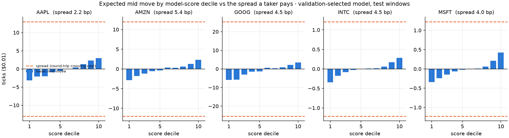
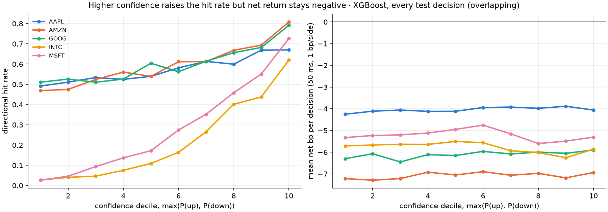

# Why positive IC coexists with negative net P&L

**Status: diagnostic.** Every number below re-reads the already-inspected walk-forward test windows of one session (21 June 2012). It explains the existing result; it is not out-of-sample confirmation. Execution uses historical displayed quotes only (one share, taker in and out, no passive fills or queue model). Displayed-quote outcomes are simulations, not realised profits. Plan: [ECONOMICS_PLAN.md](ECONOMICS_PLAN.md) (written before the numbers). Code: `src/lob_research/economics.py`; outputs: `results/economics/`.

## Numbers

**1. Where the P&L goes.** Same trades as the existing simulator, split exactly into signal (decision mid → target mid), latency, half-spread in + out, and fees. Components reconcile to the simulator trade by trade (max difference 1e-13 dollars) and to the saved `execution-sensitivity.csv` (1e-14). XGBoost, fixed 0.55 diagnostic, 50 ms, mean per trade:

| | trades | signal | latency | spread | fees 1 bp/side | net | net (ticks) |
|---|---|---|---|---|---|---|---|
| AAPL ($581) | 1,117 | +0.41 bp | −0.09 | −2.31 | −2.00 | −3.99 bp | −23.2 |
| AMZN ($221) | 735 | +0.67 | −0.18 | −5.52 | −2.00 | −7.02 | −15.6 |
| GOOG ($567) | 386 | +0.58 | −0.10 | −4.52 | −2.00 | −6.04 | −34.3 |
| INTC ($27) | 260 | +1.95 | −1.44 | −4.07 | −2.00 | −5.56 | −1.5 |
| MSFT ($30) | 547 | +1.51 | −0.99 | −3.48 | −2.00 | −4.96 | −1.5 |

The signal is positive for every stock (summed mid-to-mid it earns $1–26 per stock), and the **spread is the largest cost everywhere**, 2–8 times the signal. With zero fees every stock still loses (−2.0 to −5.0 bp); at 5 bp per side, −12 to −15 bp. Latency is negligible for the high-priced names but removes two-thirds to three-quarters of the INTC/MSFT signal at 50 ms. This is partly offset by a lower spread cost than at 0 ms (INTC 4.84 → 4.07 bp), because these decisions cluster on momentarily wide spreads that close within 50 ms. Logistic, every directional argmax prediction, 0 ms and 200 ms give the same picture (`decomposition.csv`, ).

**2. Expected move vs spread.** By score decile (validation-selected model), the largest conditional mean mid move is 0.5 bp (AAPL), 1.0–1.4 bp (others). The mean decision spread is 2.1–6.1 bp. **In 0 of 50 stock-deciles does the expected move exceed the spread**, let alone spread + 2 bp of fees. In ticks: AAPL's top decile moves +3.0 ticks against a 13-tick spread; GOOG +3.5 vs 26; INTC +0.28 vs 1.5; MSFT +0.42 vs 1.6 ().

Tick size matters, but not as "big tick means wide spread in bp". AAPL/GOOG/AMZN quote 12–26 ticks wide yet only 2.2–5.4 bp, and their mid moves several ticks. INTC/MSFT are pinned at a one-tick spread (3.3–3.7 bp): over the 100-event horizon the mid is unchanged 68–76% of the time, moves half a tick 20–26%, one tick 4–7%, and **never** more than one tick (`mid-move-distribution.csv`).

**3. Confidence ≠ expected return.** Moving from the lowest to the highest XGBoost confidence decile raises the hit rate (AAPL 0.49 → 0.67, AMZN 0.47 → 0.81, INTC 0.03 → 0.62) but mean net bp per decision stays flat and negative in every decile (AAPL ≈ −4, AMZN ≈ −7, INTC ≈ −6); at most 1% of decisions in any decile are net positive. High-confidence states also have wider spreads (INTC 1.0 → 1.5 ticks), so the larger favourable move is paid away ().

**4. Perfect-foresight ceiling.** Knowing the executable quotes in advance and choosing the better side, the share of decisions that clear the spread is 9.7% (AAPL), 2.3% (AMZN), 6.2% (GOOG) and **0%** (INTC, MSFT) with zero fees and latency; with 1 bp per side it is 0.0–0.5%; with 5 bp it is 0% for every stock. A non-overlapping look-ahead oracle (50 ms, 1 bp) makes 3–16 trades per stock and at most $0.61 over all test windows.

**5. Pre-specified cost-aware rule.** Trade only when `E[r] = P(up)·m_up − P(down)·m_down` (class-conditional moves estimated on each fold's training rows) exceeds the decision spread + 2 bp. The largest |E[r]| on any decision is 1.9 bp against mean costs of 4.3–7.5 bp, so the rule makes **0 trades on validation and 0 on test** for both models and all stocks: the model never expects to clear its own cost. (Assessed once, on already-seen windows.)

## Worked examples

- **$30 stock, 1-cent tick, one-tick spread (3.3 bp).** Bid 30.00 / ask 30.01, mid 30.005. The model correctly predicts the ask lifting to 30.02 (mid +0.5 tick, +1.7 bp). Buy at 30.01, sell at the bid 30.00: gross −$0.010; fees 1 bp per side −$0.006; net −$0.016 (−5.3 bp). Even a correctly predicted full one-tick move (30.01/30.02) gives gross $0.00 and net −$0.006. Profit needs a move beyond one tick, which never occurred for INTC or MSFT here.
- **AAPL at $581, 13-tick (2.2 bp) spread.** The top score decile moves +3.0 ticks on average. Expected per share: +3 − 13 (spread) − 11.6 (2 bp of $581) ≈ −22 ticks (−3.7 bp), close to the observed −23 ticks per trade.
- **INTC top-confidence decile.** 62% hit rate, but the mean favourable mid move is 0.37 tick against a 1.5-tick spread paid on entry and exit: ≈ −1.1 ticks before fees.

## Plain-language explanation

IC and hit rate measure whether the model **ranks** the direction of the next mid move. P&L measures whether the **size** of that move beats the cost of trading. Short-horizon mid moves are tiny: usually a fraction of a basis point on average, and for one-tick stocks often a single side of the quote moving (half a tick). A taker buys at the ask and sells at the bid, so the mid must move by more than the whole spread before fees. The classifier is trained to get class probabilities right, not to find moves larger than the spread; "70% confident of up" can still mean an expected half-tick gain against a one-tick cost. Order-book imbalance is a genuine, well-known predictor of the next price change. That is exactly why it is already reflected in where liquidity providers quote. Within this design (taker execution, 100-event horizon, displayed quotes), even perfect foresight would rarely pay. Validation therefore correctly chose not to trade. Making the signal economically useful would require a different design, such as passive execution or longer horizons, tested with a fill model on untouched sessions. That is outside this diagnostic.
