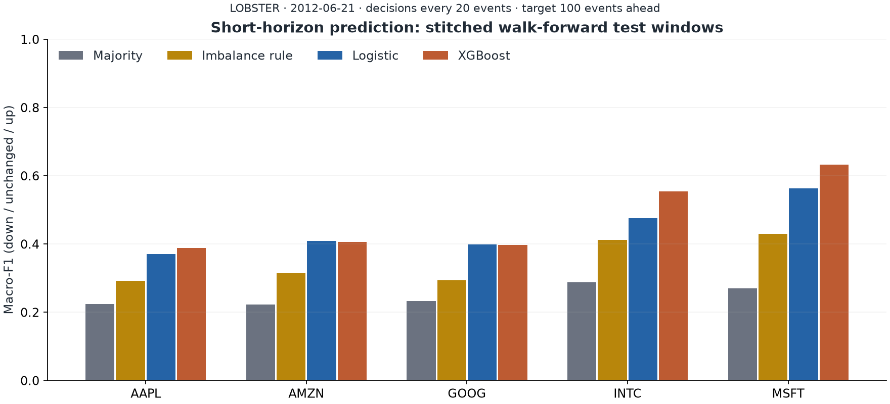
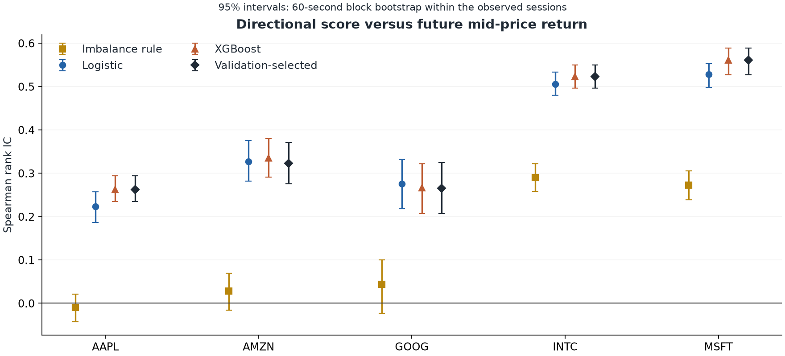
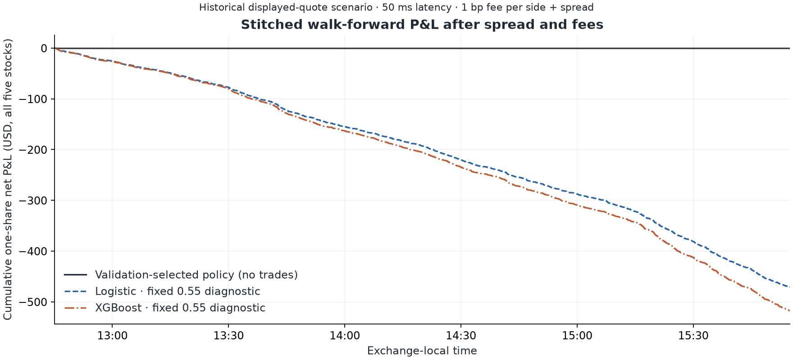
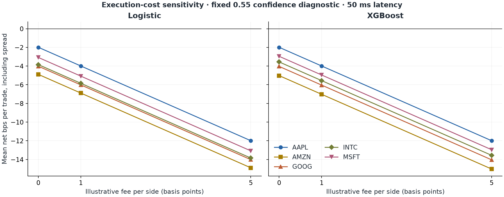

# Order book signals: walk-forward findings

The validation-selected models beat the training-majority baseline on stitched test macro-F1 for 5 of 5 stocks. Under the primary displayed-quote execution scenario, they generated 0 one-share trades and a combined net P&L of $0.00. These results cover 1 historical session(s) and do not establish a persistent trading edge.

## Data and research design

Official LOBSTER ten-level samples for AAPL, AMZN, GOOG, INTC and MSFT on 2012-06-21 contain 2,110,860 paired book events. The pipeline retained 85,408 decision observations after the fixed filters. The main run makes a decision every 20 supplied events and predicts 100 events ahead. Median realised horizon: 3.177 seconds; 10th–90th percentile: 0.003–12.968 seconds. These are venue book-update events, not a consolidated tape of every market message.

The run uses 5 expanding walk-forward folds per stock (expanding intraday walk-forward (one session)). Each fold trains on earlier observations, reserves the next interval for model/threshold selection and tests on the following interval. Test windows are disjoint and purged through target time plus the longest latency scenario. Later folds may train on earlier completed test intervals. The model parameters and candidate thresholds were fixed before real-data performance was inspected. See [research plan](RESEARCH_PLAN.md), [scope](SCOPE.md) and [experiment log](EXPERIMENT_LOG.md).

## Predictive performance

Macro-F1 averages the F1 scores for down, unchanged and up. Hit rate below is directional correctness among predicted up/down observations, counting realised flat moves as misses; coverage prevents comparison with a model that rarely takes a direction from hiding abstention. Rank IC is Spearman correlation between P(up)−P(down) and future mid-price return. Constant scores have undefined IC.

| symbol | macro_f1 | directional_hit_rate | directional_coverage | information_coefficient | ic_low | ic_high |
|---|---|---|---|---|---|---|
| AAPL | 0.3878 | 0.5734 | 1.0000 | 0.2623 | 0.2343 | 0.2937 |
| AMZN | 0.4066 | 0.5966 | 1.0000 | 0.3226 | 0.2759 | 0.3708 |
| GOOG | 0.3922 | 0.5927 | 1.0000 | 0.2657 | 0.2063 | 0.3251 |
| INTC | 0.5542 | 0.5848 | 0.1284 | 0.5233 | 0.4961 | 0.5494 |
| MSFT | 0.6322 | 0.5928 | 0.2657 | 0.5611 | 0.5275 | 0.5883 |

IC bounds resample 60-second clock blocks within the observed test series. They describe intraday sampling uncertainty, not robustness across trading days. All models, fold results, confusion matrices and paired model-minus-majority intervals are retained in `results/`. The five-stock comparisons are exploratory.

## P&L after spread and fee costs

The following table stitches the model selected by validation macro-F1 in each fold and that model's validation-selected threshold. Every executed position is one share. The scenario uses 50 ms latency, entry/exit across the observed spread and an illustrative fee of 1 bp per side.

| symbol | trades | total_net_dollars |
|---|---|---|
| AAPL | 0 | 0.0000 |
| AMZN | 0 | 0.0000 |
| GOOG | 0 | 0.0000 |
| INTC | 0 | 0.0000 |
| MSFT | 0 | 0.0000 |

No-trade is a valid outcome of validation selection. A separate fixed 0.55 confidence diagnostic shows what execution costs do to directional trades; it was specified before inspecting test outcomes and is not a strategy selected on test P&L.

## Interpretation and limits

Prediction quality and economic value are different tests. The spread is paid through actual bid/ask prices in this diagnostic, then fees are deducted from both sides. Latency scenarios use quotes available at the assumed execution times. Trades cannot overlap within a symbol, but displayed historical liquidity does not guarantee an executable fill. Borrow availability, routing, hidden liquidity and impact are not modelled. LOBSTER has already reconstructed the books; this project validates and replays those states rather than claiming a full ITCH or queue reconstruction.

The sample contains five stocks across 1 historical session(s). Event dependence, limited regime coverage and historical market structure limit generalisation. Large row counts do not create independent trading days. The fee schedule is illustrative, not a verified account-specific charge. Next evidence should come from several untouched sessions and more realistic execution data, not repeated tuning of this test window.

## Reproduce and inspect

Run `./scripts/python -m lob_research.cli download`, `./scripts/python -m pytest -q` and `./scripts/python -m lob_research.cli run` from the repository root. Exact versions are in `requirements-lock.txt`; data hashes are in `data/sample-manifest.json`; configuration, source-code hashes, run timing and result hashes are in `results/run.json`. The executed notebook reads the pipeline results and checks them against saved predictions. Raw source files, predictions and individual trade records stay local and are excluded from Git.

Sources: [LOBSTER sample downloads](https://php.lobsterdata.com/info/DataSamples.php), [LOBSTER data structure](https://php.lobsterdata.com/info/DataStructure.php). All reported results are generated from the actual downloaded files.
